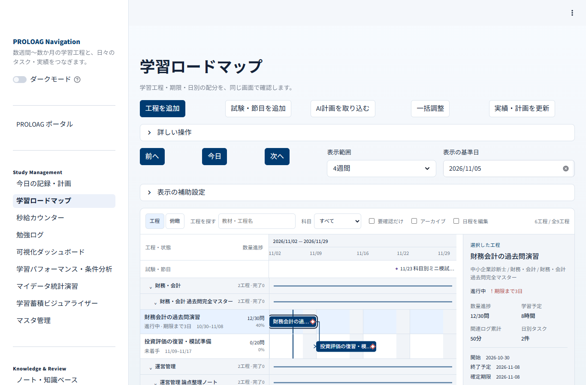

# 参照資料：元のローカル版

以下は元のローカル版を説明した歴史的な参照資料です。本文中の「公開準備中」「ライセンス未確定」「LICENSE_STATUS.md」は当時の状態を示します。現行のPROLOAG本体には独自の[PROLOAG 利用条件（販売・有料提供禁止）第1版](../LICENSE)（`LicenseRef-PROLOAG-No-Sale-1.0`）が適用されます。

この資料の通常版セットアップはWeb展示版では使いません。[Web展示版の案内](../WEB_DEMO_README.md)を参照してください。

# PROLOAG

**Progress & Reflection OS for Learning, Organization, And Growth**

今日の記録を、次の物語へ。

> 公開準備中のソースです。PROLOAG本体の公開ライセンスは未確定です。[LICENSE_STATUS.md](../LICENSE_STATUS.md)を確認してください。

PROLOAGは、学習計画・計測・ノート・復習と、睡眠・体調・運動などの生活記録をまとめるローカルアプリです。中期の計画を日々のタスクと学習実績につなぎ、記録を振り返ることを目的にしています。

Streamlitを使い、ブラウザで操作します。記録はアプリを実行するPC内のJSONへ保存します。Google連携は任意の手動操作で、基本機能にGoogleアカウントやAIのAPI接続は不要です。

## できること

| 分野 | 主な機能 |
|---|---|
| 学習の計画と実行 | 今日のタスク、繰越、ガント形式のロードマップ、日別配分、AIが作成した計画JSONの確認・取り込み |
| 学習時間の記録 | 秒給カウンター、Chrome/Edge対応の小窓、一時停止・再開、手動ログ、編集・削除・復元 |
| 知識と復習 | ノート、カード、復習リマインダー、知識都市、学習蓄積ビジュアライザー |
| 生活記録と振り返り | 日記、服薬・カフェイン、睡眠・体調、運動、生活と学習の推移・条件比較 |
| データの利用 | 全記録CSV・ZIP、旧版勉強ログの移行、データ整合性チェック、マイデータ統計演習 |
| Hobby & Tools | MP4→MP3、日本語・英語の文字起こし、画像・PDFの文字読み取り（追加準備が必要） |

ポータルを含む29ページを、目的別のナビゲーションにまとめています。すべての機能を使わず、必要な記録から始められます。

## 画面例



架空Demoの画面例です。2026年11月5日を基準にしたサンプル計画で、実際の試験日程・学習成果を示すものではありません。

## 試す方法を選ぶ

| 方法 | 対象 | 必要な準備 |
|---|---|---|
| 通常版ZIP | 自分の記録を空の状態から始めたい | Python本体同梱。初回ライブラリ導入時はネット接続 |
| Demo版ZIP | 架空データで画面・入力・分析を試したい | 180日分の架空データと少量のロードマップを収録 |
| このソース | コードを読み、開発環境で動かしたい | Python 3.11、依存ライブラリの導入 |

配布ZIPはGitHubの「Releases」に公開する想定です。公開前はダウンロード先がまだありません。このリポジトリから得るソースには、Pythonランタイム・導入済みライブラリ・個人記録を含めません。

## ソースから起動する

検証の基準は **Windows x64 / Python 3.11** です。ほかのOSでの動作は今回の検証範囲に含めていません。

ソースを新しい書き込み可能なフォルダへ配置し、そのフォルダでPowerShellを開いて実行します。

```powershell
py -3.11 -m venv .venv
.\.venv\Scripts\python.exe -m pip install -r requirements-release.lock.txt
.\.venv\Scripts\python.exe scripts/init_local_data.py
.\.venv\Scripts\python.exe -m streamlit run main.py --server.address localhost --server.port 8502
```

`init_local_data.py`は空の初期JSONと必要なフォルダを用意し、既存ファイルを上書きしません。準備が終わったら、ブラウザで `http://localhost:8502/` を開きます。終了は起動したコンソールで Ctrl+C を押します。同じポートで別のアプリが起動している場合は、対象を確認してから、未使用のポートを手動指定して使い分けてください。

Windowsでは`run_app.bat`からも起動できます。READMEの初期セットアップ後、この公開用ランチャーはPython 3.11の専用`.venv`を使います。依存は初期セットアップで固定定義から導入します。

`requirements-release.lock.txt`はWindows/Python 3.11で確認した基本依存の固定定義です。ソース用の`requirements.txt`と、任意機能用の依存定義も分けています。

初回は「マスタ管理」で分類、「ユーザー設定」で入力初期値を確認し、「今日の記録・計画」や「秒給カウンター」から記録できます。詳しい操作はアプリ内の「使い方ガイド」にあります。

## 追加準備が必要な機能

- [メディア変換](../docs/media-conversion.md)：FFmpeg/FFprobe。
- [文字起こし](../docs/transcription.md)：FFmpeg/FFprobe、専用エンジン、初回モデル取得。
- [画像・PDFの文字読み取り](../docs/ocr.md)：専用エンジン・モデル等。
- [Google Sheets共有](../docs/google-sheets-setup.md)・[Google Docs相談レポート](../docs/google-docs-reports.md)：任意依存と、自分のGoogle設定・認証。

これらを準備しなくても、基本の学習・生活記録を利用できます。認証情報・モデル・教材や音声の原本は公開ソースに含めません。

## 構成と設計の見どころ

- ページ、機能サービス、共通UI部品を分け、保存や集計を共用しています。
- JSONの版確認・排他・一時ファイルからの置換を使い、複数ファイルの操作にはジャーナルと復旧処理を用意しています。
- タイマーの秒表示と入力を部分更新で分け、入力のたびに周囲の集計を実行しない構成を使っています。
- ロードマップは期間・数量進捗・記録時間を分け、AIからの取り込みもプレビュー確認後に保存します。
- 時間のかかる変換・認識はバックグラウンド処理へ分け、進捗・中止・結果の確認を用意しています。

具体的なモジュールと境界は[アーキテクチャ](../docs/architecture.md)、変更時の進め方は[開発ガイド](../docs/development.md)にまとめています。

## テストと配布

自動テストは`unittest`を使っています。保存・競合・入力保持・集計・取り込み・配布物の除外などを、架空データと一時ディレクトリで確認します。[テスト手順と範囲](../docs/testing.md)を参照してください。

```powershell
.\.venv\Scripts\python.exe scripts/run_tests.py --suite core
```

FFmpegやOCR専用依存が必要な検証は別のintegration群です。使用済みの実記録があるフォルダをテスト対象にせず、テストガイドに従って実行してください。

通常版とDemo版は同じアプリコードを使い、初期データとDemo設定を分けます。ビルド・Demo生成・検査の手順は[配布物の作成](../docs/building.md)にあります。過去の配布検証結果を、今後の変更すべての動作保証とは扱いません。

今回の整理で実行した条件と範囲は[公開準備時の検証記録](../docs/verification.md)にあります。

## 記録の保管と既知の制限

記録はプロジェクト内の`study_logs/`、`daily_plans/`、`notes_data/`、`settings/`等へ保存します。使用後のフォルダには個人情報が残るため、Gitへ登録・再配布するのは公開用ソースと未使用の配布物だけにしてください。CSV・ZIP出力は一覧・分析用で、アプリ全体の完全復元機能ではありません。

この版には入力・表示・編集導線の既知の制限があります。[既知の制限](../docs/known-limitations.md)を確認してください。分析は記録上の傾向を示し、因果関係・理解度・健康状態を確定するものではありません。

## 利用ガイド

- [学習ロードマップ](../docs/study-roadmap.md)
- [AI計画の取り込み](../docs/roadmap-ai-import.md)・[GPT/Geminiへ渡す指示書](../docs/ai-roadmap-import-prompt.md)
- [旧版勉強ログの移行](../docs/legacy-study-import.md)
- [相談提案の取り込み](../docs/consultation-proposals.md)

## ライセンス

PROLOAG本体の公開ライセンスは未確定です。[LICENSE_STATUS.md](../LICENSE_STATUS.md)を参照してください。第三者ソフトの利用条件・表示は、そのソフトに付属する文書を基準にしてください。
